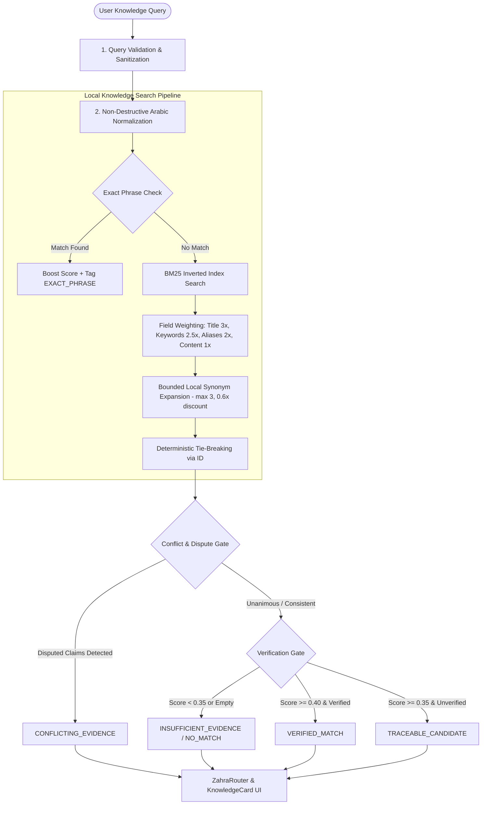

# Zahra 3 — Phase 3: Local Knowledge Engine
**System Architecture, Epistemic Specification & Verification Documentation**
**Core Guiding Principle:** *Truth Before Intelligence (الحقيقة قبل الذكاء)*
**Operating Mode:** 100% Offline, Zero-LLM, Zero-Transformer, Zero-Network, Zero-Telemetry

---

## 1. Executive Summary & Epistemic Framework

Phase 3 introduces the **Local Knowledge Engine** for Zahra 3, transforming the application into a structured, searchable, verifiable offline knowledge system without employing any neural language models, external cloud APIs, or remote embeddings.

### The Five Epistemic States
In strict adherence to the project's guiding principle, Zahra explicitly separates:
1. **Document Existence**: A physical knowledge record exists within local storage.
2. **Retrieval Relevance**: A record matches the query tokens or phrases above mathematical relevance thresholds.
3. **Traceable Source**: The record provides verifiable citations to primary canonical or empirical literature.
4. **Verified Claim**: The record has satisfied structural validation AND recognized canonical, scholarly consensus, or empirical measurement verification standards.
5. **Epistemic Abstention**: The local knowledge base lacks sufficient traceable evidence, triggering an honest, structured refusal rather than hallucination or speculative guessing.

---

## 2. Architectural Blueprint & Data Flow

---

## 3. Knowledge-Record Schema

Every knowledge entry is structured as a typed, versioned `KnowledgeRecord`:

| Field | Type | Description |
|---|---|---|
| `id` | `String` | Stable unique identifier (`[a-zA-Z0-9_-]{3,100}`). |
| `category` | `KnowledgeCategory` | Domain: `QURAN`, `HADITH`, `FIQH`, `SCIENCE`, `HISTORY`, `GEOGRAPHY`, `TECH`, `HEALTH`, `GENERAL`. |
| `title` | `String` | Canonical title of the claim or entry. |
| `canonicalContent` | `String` | Curated, verified answer text and explanation. |
| `originalSourceText` | `String` | **Unaltered original verbatim source text** (preserves tashkeel and punctuation). |
| `language` | `String` | Text language (`"ar"`, `"en"`, `"mixed"`). |
| `normalizedText` | `String` | Derived pre-computed normalized form for indexing. |
| `keywords` | `List<String>` | High-weight domain-specific terms. |
| `aliases` | `List<String>` | Alternative titles and colloquial phrasings. |
| `provenance` | `KnowledgeProvenance` | Immutable citation metadata (`origin`, `sourceTitle`, `sourceId`, `sourceLocation`, `authorOrNarrator`, `grading`, `ingestDate`). |
| `verificationStatus` | `VerificationStatus` | Epistemic status: `VERIFIED_CANONICAL`, `VERIFIED_SCHOLARLY`, `VERIFIED_EMPIRICAL`, `UNVERIFIED_CLAIM`, `DISPUTED`, `REFUTED`. |
| `verificationNotes` | `String` | Documented audit notes on verification methodology. |
| `relatedRecordIds` | `List<String>` | Cross-references to related corpus records. |
| `schemaVersion` | `Int` | Schema evolution version integer (defaults to `1`). |

---

## 4. Storage & Inverted Index Architecture

1. **Storage Layer (`LocalKnowledgeStore`)**:
   - Synchronous, atomic persistence via `KnowledgeStorageDriver`.
   - Strict validation barrier: `KnowledgeRecordValidator.validate(record)` rejects malformed or un-sourced records at insertion time.
   - Accidental overwrite protection: Rejecting duplicate ID mutations without explicit update invocation.
   - Provenance preservation: Updating a record retains the original ingestion timestamp and author provenance.
   - Complete logical isolation: Guaranteed zero interaction with personal user facts (`SafeMemoryStore`).

2. **Offline Inverted Index (`OfflineKnowledgeIndex`)**:
   - In-memory Posting lists: `Term -> List<Posting(recordId, termFreq, fieldWeight)>`.
   - Field weights: `WEIGHT_TITLE = 3.0`, `WEIGHT_KEYWORDS = 2.5`, `WEIGHT_ALIASES = 2.0`, `WEIGHT_CONTENT = 1.0`.
   - Length-normalized BM25-style term scoring with IDF:
     $$Score(D, Q) = \sum_{t \in Q} IDF(t) \cdot \frac{TF(t, D) \cdot (k_1 + 1)}{TF(t, D) + k_1 \cdot (1 - b + b \cdot \frac{|D|}{avgdl})} \cdot W_{field}$$
   - Exact phrase bonus (+1.2 score weight) ensuring literal citations outrank fragmented token overlaps.
   - Deterministic tie-breaking: identical scores sorted stably by `record.id`.

---

## 5. Arabic Language Handling & Normalization

The `ArabicKnowledgeNormalizer` operates non-destructively:
- **Tashkeel & Tatweel Removal**: Strips harakat (`\u064B-\u065F`, `\u0670`) and kashida (`\u0640`) for index lookup, while preserving the raw source quotation in `originalSourceText`.
- **Alef Unification**: Maps `أ`, `إ`, `آ`, `ٱ` to bare alef `ا`.
- **Yaa & Alef Maqsura**: Maps `ى`, `ئ` to `ي`.
- **Taa Marbuta**: Maps `ة` to `ه`.
- **Digits Normalization**: Translates Arabic-Indic numerals (`٠-٩`) to ASCII (`0-9`).
- **Bounded Stemming**: Strips definite article prefix `ال` and conjunction prefix `و` only when remaining root length $\ge 3$ and word is not an intrinsic root (e.g. `الله`, `وقت`, `ولد`, `الماس` are protected).
- **Domain Framing Stop Words**: Filters generic framing words (`حديث`, `أحاديث`, `النبي`, `رسول`, `سورة`, `آية`, `قرآن`) to prevent keyword traps and first-record bias.

---

## 6. Offline Synonym Dictionary

- Local, deterministic mapping dictionary (`OfflineSynonymDictionary`).
- Bounded query expansion: Max 3 expansions per term.
- Cycle protection via bidirectional hash indexing.
- Penalty factor: Synonym-derived matches are discounted by $0.60\times$, guaranteeing that direct matches always outrank synonym expansions.

---

## 7. Conflict Detection & Epistemic Abstention

- **Conflict Detection**: When multiple top records within score delta $\le 0.15$ exhibit `DISPUTED` or `REFUTED` statuses, the engine flags `CONFLICTING_EVIDENCE` and presents both viewpoints rather than picking a winner arbitrarily.
- **Unverified Warnings**: If a record has status `UNVERIFIED_CLAIM`, it is surfaced with state `TRACEABLE_CANDIDATE` and an amber integrity warning banner.
- **Honest Refusal**: If candidate relevance score $< 0.35$ or corpus has zero matches, the engine returns `INSUFFICIENT_EVIDENCE` or `NO_MATCH` with explicit abstention text.
